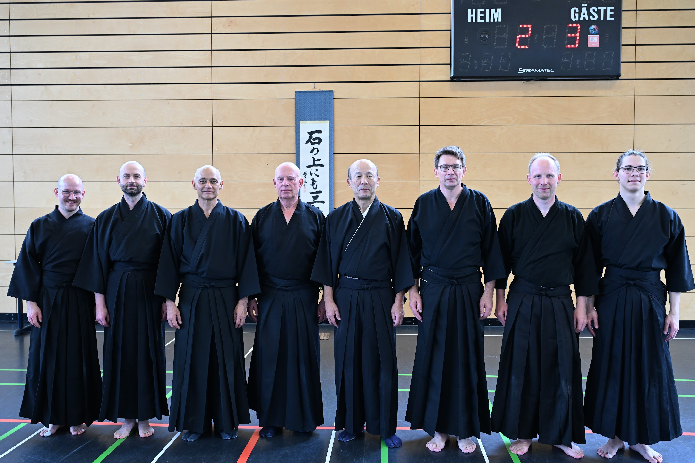

Wie schon im vergangenen Jahr reisten Richard und Nico nach Laufen in Bayern zum jährlichen Europäischen Seminar der Kokusai Renmei. Zu den Highlights gehörten eine Einheit Tachi Uchi no Kurai mit Matsumoto Sensei sowie zwei aufeinanderfolgende Einheiten Tatehiza mit DeNoon Sensei. Einmal mehr konnte unser Ukigumo nicht wirklich überzeugen! 🤣\
\
Was die Dan-Shinza betrifft, legte Richard erfolgreich seine Prüfung zum Godan ab und freute sich über die großartige Gesellschaft von Sebastian (Dojo Berlin). Auch Gunnar (Dojo Potsdam) erreichte einen neuen Rang und führte die Gruppe anschließend noch zu einem gemeinsamen Eis zur Feier des Tages! 🍨 Herzlichen Glückwunsch an alle – ihr seid die Besten!\
\
Ein ganz besonderer Dank geht an unseren Gastgeber Anselm sowie an Gunnar für all die hochwertigen Fotos. Wir können es kaum erwarten, beim nächsten Mal wieder dabei zu sein! 😊

Dieser Beitrag wurde auch auf Instagram veröffentlicht:


